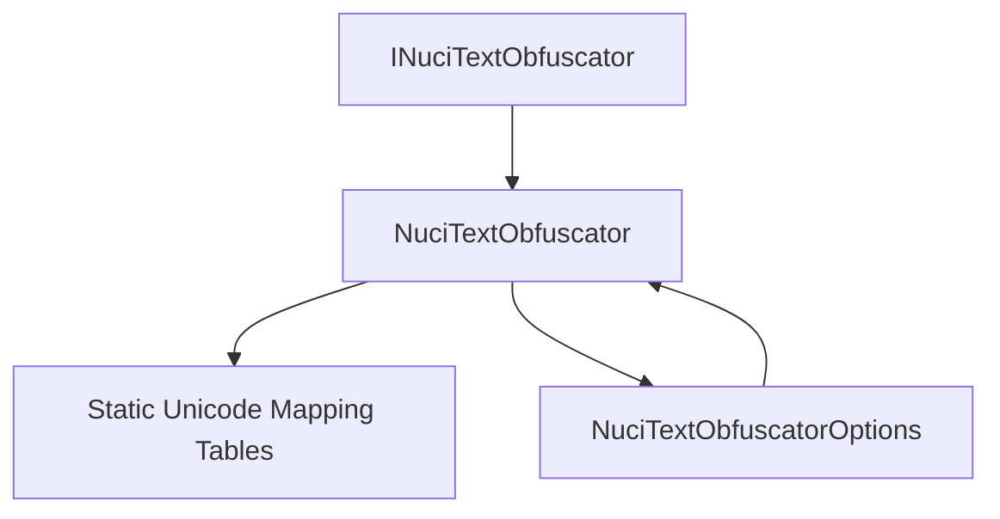
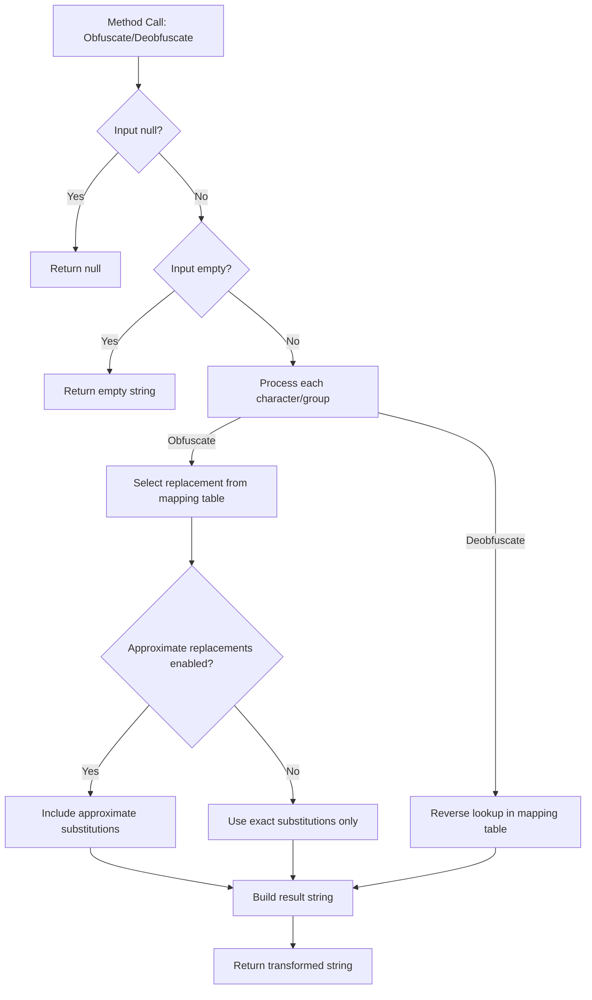
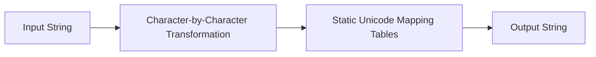
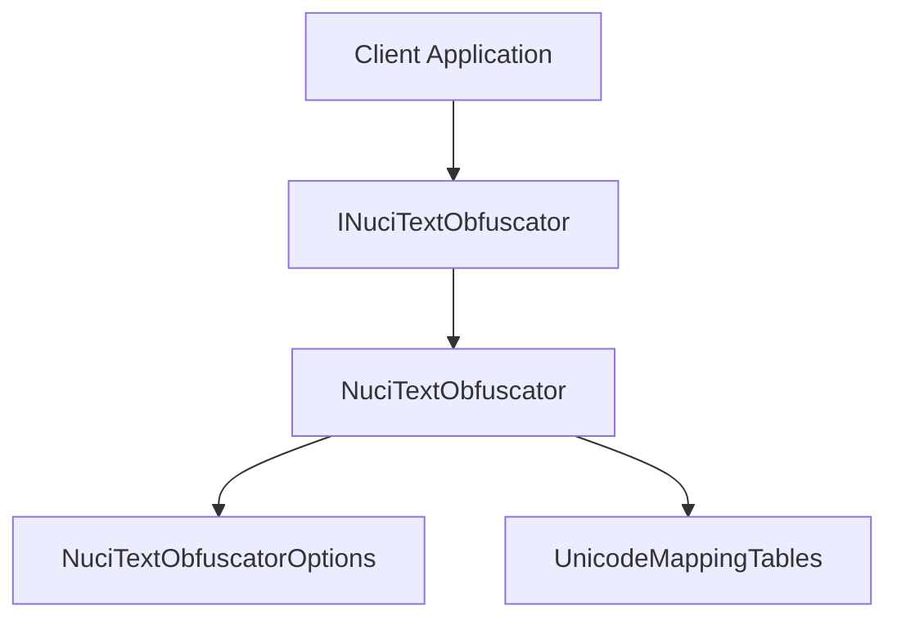

# NuciText.Obfuscation Architecture

This document describes the current architecture of the NuciText.Obfuscation library.

## 📑 Table of Contents

- [Purpose](#purpose)
- [System Context](#system-context)
- [Architectural Style](#architectural-style)
- [Runtime Flow](#runtime-flow)
- [Components](#components)
- [Data Architecture](#data-architecture)
- [Interfaces and Integrations](#interfaces-and-integrations)
- [Dependency Direction and Rules](#dependency-direction-and-rules)
- [External Dependencies](#external-dependencies)
- [Deployment and Operations](#deployment-and-operations)
- [Compatibility Contracts](#compatibility-contracts)
- [Testing and Verification](#testing-and-verification)

## 🎯 Purpose

NuciText.Obfuscation is a pure .NET library that provides text obfuscation and deobfuscation capabilities using visually similar Unicode character substitutions. The library is designed as a single, self-contained component with no external dependencies, suitable for inclusion in any .NET application.

## 🌐 System Context

The library operates as an in-memory text transformation component with no external system interactions.


The principal external boundaries are:
- **Client Application:** Consumes the library's public API (`INuciTextObfuscator`, `NuciTextObfuscatorOptions`) and provides input text strings for transformation.

## 🏗️ Architectural Style

The library follows a **single-component library** architectural style with a clean public interface (`INuciTextObfuscator`) and a concrete implementation (`NuciTextObfuscator`). The design emphasises:
- Zero external dependencies
- Deterministic behaviour when seeded
- Thread-safe stateless operations
- Minimal API surface



The principal architecture boundaries are:
- **Public API (`INuciTextObfuscator`):** Defines the contract for obfuscation and deobfuscation operations.
- **Implementation (`NuciTextObfuscator`):** Contains the transformation logic and mapping tables.
- **Configuration (`NuciTextObfuscatorOptions`):** Controls optional behaviour (approximate replacements).

## 🔄 Runtime Flow



The principal runtime sequence is:
1. **Input validation** — Handle null and empty string inputs
2. **Character processing** — Iterate through input text, identifying single characters or groups
3. **Mapping lookup** — For obfuscation: select replacement from mapping tables; for deobfuscation: reverse lookup
4. **Options application** — Apply approximate replacement logic if enabled
5. **Result construction** — Build and return the transformed string

## 🧩 Components

| Component | Responsibility | Principal Dependencies | Lifetime or Ownership |
|-----------|----------------|------------------------|-----------------------|
| `INuciTextObfuscator` | Public interface defining obfuscation/deobfuscation contract | None | Singleton per consumer |
| `NuciTextObfuscator` | Core implementation with transformation logic | `NuciTextObfuscatorOptions` (optional) | Transient or singleton |
| `NuciTextObfuscatorOptions` | Configuration options for obfuscation behaviour | None | Value object, per-call or shared |
| `UnicodeMappingTables` | Static readonly mapping tables for character substitutions | None | Static, application lifetime |

## 💾 Data Architecture

The library maintains no persistent state. All data transformations occur in-memory using static mapping tables.



| Data or Store | Owner | Representation and Storage | Lifecycle or Consistency |
|---------------|-------|----------------------------|--------------------------|
| `UnicodeMappingTables` | `NuciTextObfuscator` | Static readonly `Dictionary<string, string[]>` and reverse lookup `Dictionary<string, string>` | Application lifetime, immutable after initialisation |
| `Input Text` | Caller | `string` parameter | Method scope |
| `Output Text` | Caller | `string` return value | Method scope |

## 🔌 Interfaces and Integrations

| Interface or Integration | Direction | Contract | Owner | Failure Semantics |
|--------------------------|-----------|----------|-------|-------------------|
| `INuciTextObfuscator.Obfuscate(string)` | Inbound | Returns obfuscated string or null | `NuciTextObfuscator` | Returns null for null input; empty string for empty input |
| `INuciTextObfuscator.Obfuscate(string, NuciTextObfuscatorOptions)` | Inbound | Returns obfuscated string with options | `NuciTextObfuscator` | Returns null for null input; empty string for empty input |
| `INuciTextObfuscator.Deobfuscate(string)` | Inbound | Returns deobfuscated string or null | `NuciTextObfuscator` | Returns null for null input; empty string for empty input |

## 🧭 Dependency Direction and Rules



The principal dependency rules are:
- Client applications depend only on `INuciTextObfuscator` abstraction
- `NuciTextObfuscator` implements `INuciTextObfuscator` and has no external dependencies
- `NuciTextObfuscatorOptions` is a plain data object with no dependencies
- Mapping tables are internal implementation details

## 📦 External Dependencies

| Dependency | Responsibility | Integration Boundary | Architectural Consequence |
|------------|----------------|----------------------|---------------------------|
| None | The library has zero external dependencies | N/A | Fully self-contained, no supply chain risk |

## 🚀 Deployment and Operations

| Concern | Current Design | Architectural Consequence |
|---------|----------------|---------------------------|
| Distribution | NuGet package (`NuciText.Obfuscation`) | Standard .NET library consumption |
| Target Framework | net10.0 | Requires .NET 10.0 or compatible runtime |
| State | Stateless | Thread-safe, suitable for singleton or transient registration |
| Native Dependencies | None | Fully managed, cross-platform |

## 🛡️ Compatibility Contracts

| Contract | Owner | Invariant | Verification | Change Policy |
|----------|-------|-----------|--------------|---------------|
| `INuciTextObfuscator` interface | `NuciText.Obfuscation` | Method signatures, null/empty behaviour, deterministic output with fixed seed | Unit tests in `NuciText.Obfuscation.UnitTests` | Breaking changes require major version bump |
| `NuciTextObfuscatorOptions` properties | `NuciText.Obfuscation` | Property names, types, default values | Unit tests | Additive only; no removal without major version |
| Mapping table behaviour | `NuciText.Obfuscation` | Deobfuscation reverses obfuscation for known mappings | Round-trip tests | Preserve reversibility; additions only |

## ✅ Testing and Verification

The library includes a dedicated unit test project (`NuciText.Obfuscation.UnitTests`) using NUnit 4.x.

Execute the principal automated verification with:

```bash
dotnet test
```

Test coverage includes:
- Null and empty string handling
- Deterministic output with fixed seeds
- Round-trip obfuscation/deobfuscation
- Approximate replacement behaviour
- Character and group substitution accuracy