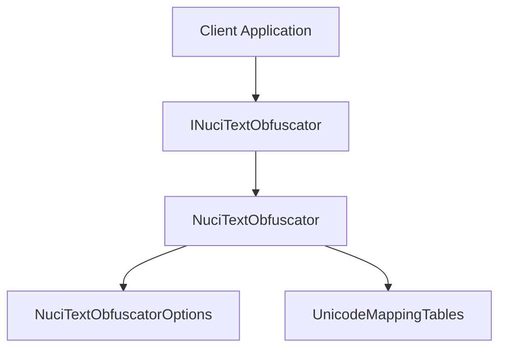

# NuciText.Obfuscation Architecture

High-level architecture documentation complementing the root ARCHITECTURE.md.

## Purpose

This document elaborates on the root ARCHITECTURE.md with implementation-level detail for developers working on the codebase.

## System Boundary

NuciText.Obfuscation is a pure .NET library with no external dependencies. It operates entirely in-memory as a text transformation component.


## Architectural Style

Single-component library with:
- Clean public interface (`INuciTextObfuscator`)
- Concrete implementation (`NuciTextObfuscator`)
- Static mapping tables for Unicode substitutions
- Configuration via `NuciTextObfuscatorOptions` value object

## Components

| Component | Responsibility | Lifetime |
|-----------|----------------|----------|
| `INuciTextObfuscator` | Public contract for obfuscation/deobfuscation | Per-consumer |
| `NuciTextObfuscator` | Core transformation logic | Transient or singleton |
| `NuciTextObfuscatorOptions` | Configuration (approximate replacements) | Per-call or shared |
| `UnicodeMappingTables` | Static readonly substitution dictionaries | Application lifetime |

## Runtime Flow

### Obfuscation

```mermaid
flowchart TD
    Start[Obfuscate(text, options?)] --> NullCheck{text null?}
    NullCheck -->|Yes| ReturnNull[Return null]
    NullCheck -->|No| EmptyCheck{text empty?}
    EmptyCheck -->|Yes| ReturnEmpty[Return empty string]
    EmptyCheck -->|No| GroupReplace[Replace character groups]
    GroupReplace --> ApproxCheck{Approximate enabled?}
    ApproxCheck -->|Yes| ApproxGroupReplace[Replace approximate groups]
    ApproxCheck -->|No| CharProcess[Process characters]
    ApproxGroupReplace --> CharProcess
    CharProcess --> BuildResult[Build result string]
    BuildResult --> ReturnResult[Return transformed string]
```

### Deobfuscation

```mermaid
flowchart TD
    Start[Deobfuscate(text)] --> NullCheck{text null?}
    NullCheck -->|Yes| ReturnNull[Return null]
    NullCheck -->|No| EmptyCheck{text empty?}
    EmptyCheck -->|Yes| ReturnEmpty[Return empty string]
    EmptyCheck -->|No| GroupReverse[Reverse group replacements]
    GroupReverse --> ApproxGroupReverse[Reverse approximate group replacements]
    ApproxGroupReverse --> CharReverse[Reverse character replacements]
    CharReverse --> BuildResult[Build result string]
    BuildResult --> ReturnResult[Return transformed string]
```

## Data Architecture

No persistent state. All transformations use static readonly mapping tables:

- `IdenticalGroupReplacements` — Multi-character exact substitutions
- `ApproximateGroupReplacements` — Multi-character approximate substitutions
- `IdenticalReplacements` — Single-character exact substitutions
- `ApproximateReplacements` — Single-character approximate substitutions

## Dependency Direction



Rules:
- Clients depend only on `INuciTextObfuscator`
- `NuciTextObfuscator` has zero external dependencies
- Mapping tables are internal implementation details

## Compatibility Contracts

| Contract | Invariant | Verification |
|----------|-----------|--------------|
| `INuciTextObfuscator` interface | Method signatures, null/empty behaviour, deterministic output with fixed seed | Unit tests |
| `NuciTextObfuscatorOptions` | Property names, types, default values | Unit tests |
| Mapping tables | Deobfuscation reverses obfuscation for known mappings | Round-trip tests |

## Testing and Verification

```bash
dotnet test
```

Coverage includes:
- Null and empty string handling
- Deterministic output with fixed seeds
- Round-trip obfuscation/deobfuscation
- Approximate replacement behaviour
- Character and group substitution accuracy

## Design Constraints

- Zero external dependencies (supply chain security)
- Thread-safe stateless operations
- Deterministic when seeded
- Cross-platform (.NET 10.0+)
- GPL-3.0-or-later license